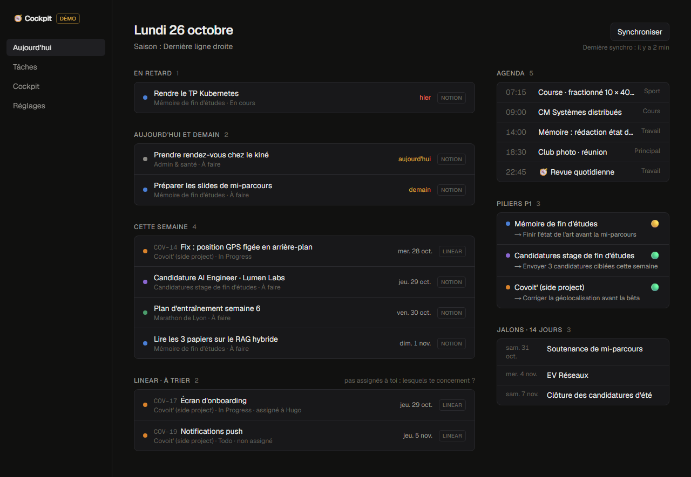
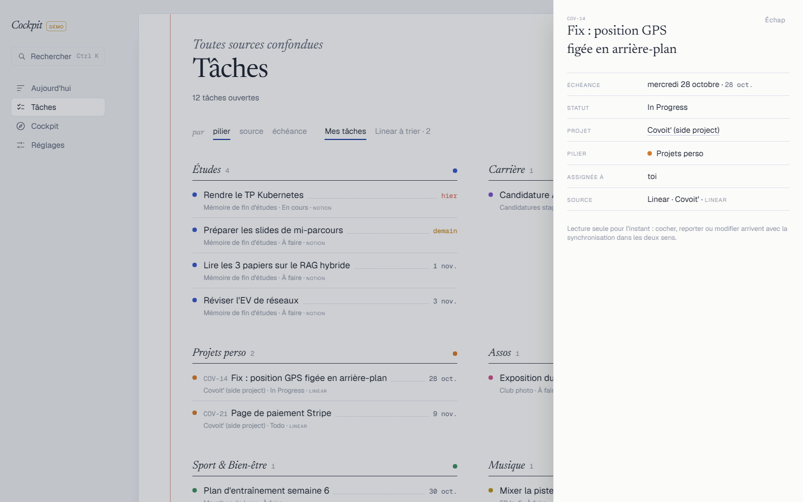
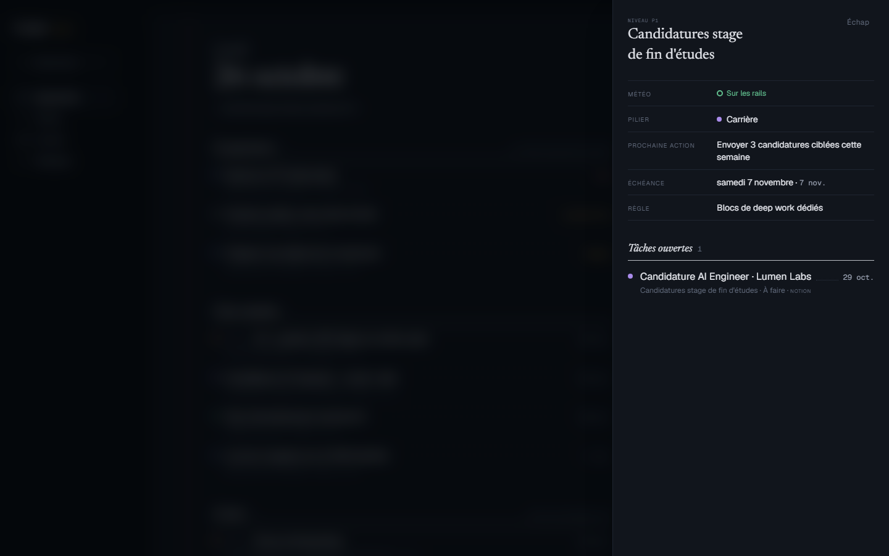
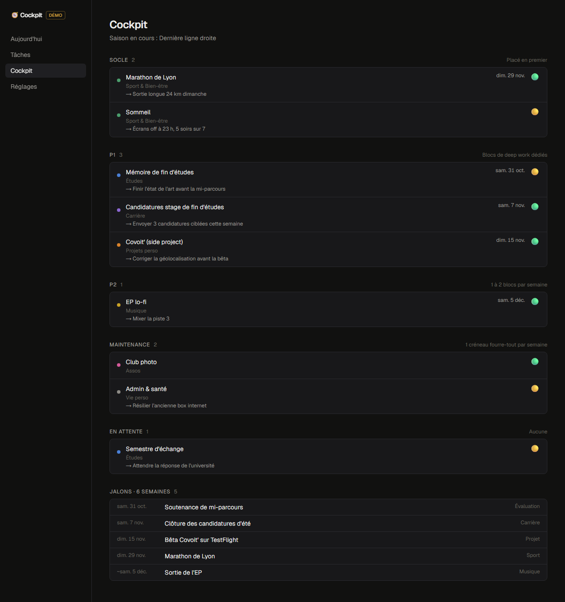
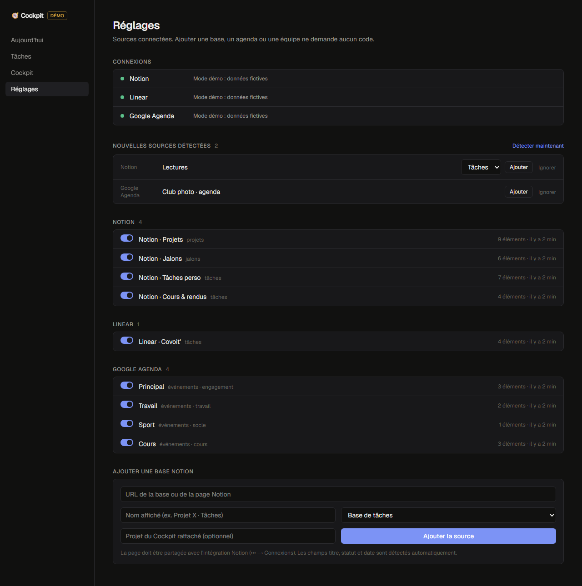
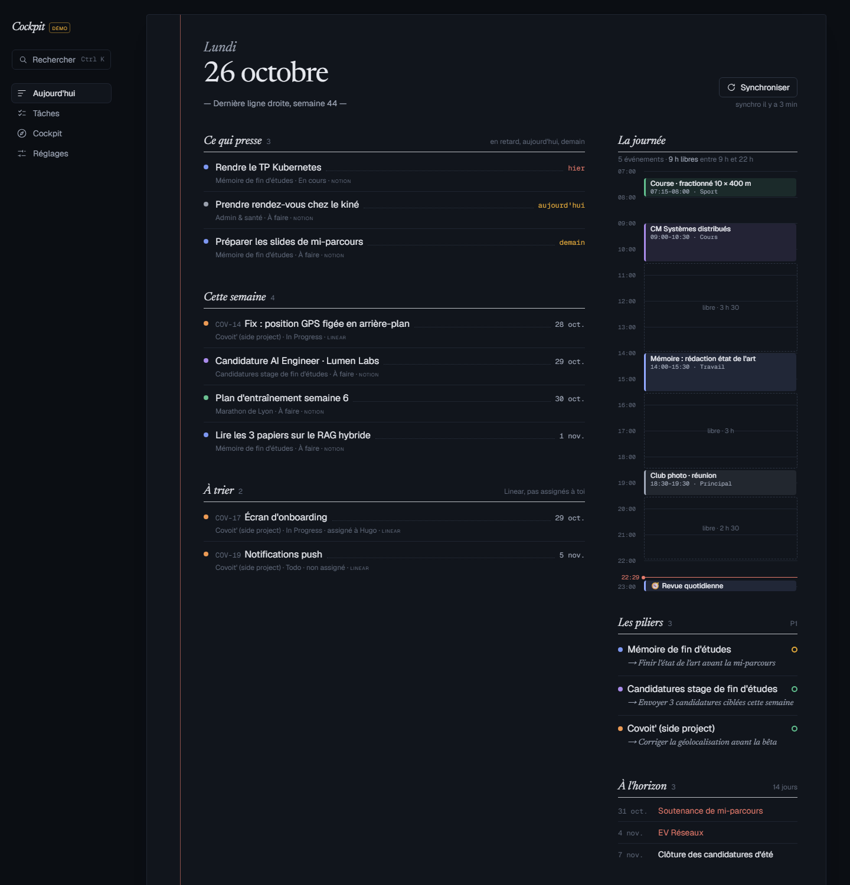
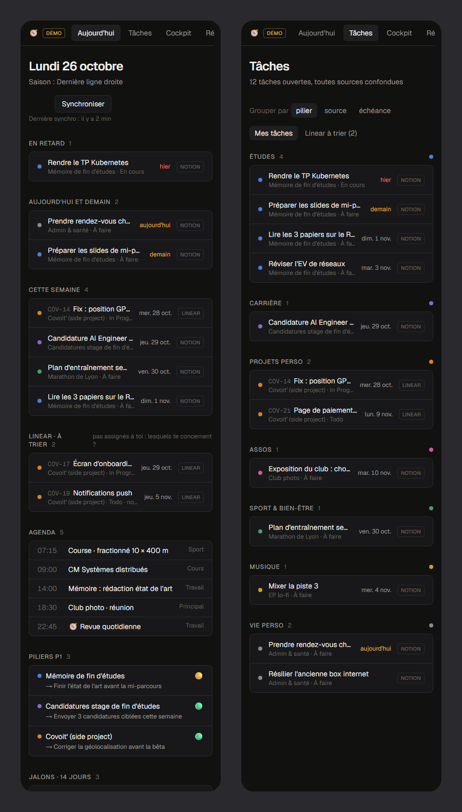

# 🧭 Cockpit

**A personal life dashboard that turns scattered tools into one operating system.**

My planning lived in a dozen places: a Notion "cockpit" for projects and priorities, nine separate Notion task databases, Linear for group projects, a dozen Google calendars, an Obsidian vault and a paper notebook. Weekly reviews meant opening ten tabs before thinking anything through.

Cockpit pulls all of it into one local-first app built around my own method: **pillars** (life areas) → **projects** ranked by **level** (Socle / P1 / P2 / Maintenance / En attente) with a **weather** status → **tasks**, **milestones** and **calendar events**. The interface is in French, the language I plan in.

> Status: **slice 1 of 12**, read-only sync with Notion, Linear and Google Calendar plus four screens. See the [roadmap](#roadmap).



<sub>Screenshots use the built-in fictional demo dataset (`npm run demo`), not real accounts.</sub>

## Try it in 30 seconds

```bash
npm install
npm run demo   # fictional data, no API keys needed → http://localhost:3000
```

## What it does today

| Screen | Purpose |
|---|---|
| **Aujourd'hui** | What's pressing (late, today, tomorrow) and this week's tasks from every source; **the day drawn to scale**, with free slots between 9 h and 22 h measured out (groundwork for time-blocking) and a "now" line; P1 projects with their next action; milestones and exams for the next 14 days; Linear tickets waiting to be claimed |
| **Tâches** | Every open task across all sources, grouped by pillar, by source or by due date |
| **Cockpit** | Projects grouped by level with weather and next action, the max-3-P1 rule flagged, a 6-week milestone timeline |
| **Réglages** | Source registry: per-source status and errors, on/off switches, auto-discovery of new Notion databases, Linear teams and calendars, add a Notion database by pasting its URL |
| **Everywhere** | `Ctrl K` command palette (navigation, accent-insensitive search over tasks and projects, sync) · detail panels for tasks and projects, addressable by URL (`?t=` / `?p=`) and closed with `Esc` · bottom tab bar on phones |

**Design.** A French *grands carreaux* notebook: cool white paper with a red margin line, blue-black fountain-pen ink, Newsreader serif headings and planner-style dot leaders between a task and its date. The dark theme is the same notebook at night.

<table>
  <tr>
    <td width="50%"><br><sub><b>Task detail</b>: opened from any list, from search, or by URL</sub></td>
    <td width="50%"><br><sub><b>Project detail</b> (dark theme): weather, next action and its open tasks across sources; the page behind is dimmed and blurred</sub></td>
  </tr>
  <tr>
    <td width="50%"><br><sub><b>Cockpit</b>: the season's projects by level, with a milestone timeline</sub></td>
    <td width="50%"><br><sub><b>Réglages</b>: sources are data; new ones are detected and added in one click</sub></td>
  </tr>
  <tr>
    <td width="50%"><br><sub><b>Dark theme</b>: follows the system setting</sub></td>
    <td width="50%"><br><sub><b>Phone</b>: bottom tab bar, columns stack</sub></td>
  </tr>
</table>

## Design principles

- **Everything is data, nothing is an enum.** Pillars, levels, seasons and sources are rows, not code. A new project, semester or tool must never require a code change.
- **Pluggable connectors.** Each tool implements one small interface (`missingSetup / pull / discover`). Adding Todoist or Apple Health means adding one file.
- **Schema inference.** Notion databases name their fields differently (`Status`/`Statut`, `Due`/`Date`/`Échéance`). The Notion connector reads each schema and guesses the title, status and date mapping, resolving status groups to todo/doing/done.
- **Sources stay the source of truth.** Each pull is the complete state of a source and is swapped in atomically. Write-back to the home tool comes in later slices.
- **Local-first.** SQLite on disk today. The same libSQL driver moves to Turso when the app goes online for phone access.

More detail in [docs/ARCHITECTURE.md](docs/ARCHITECTURE.md); product decisions and the next slice in [docs/SPEC.md](docs/SPEC.md).

## Stack

Next.js 16 (App Router, Cache Components, Server Actions) · React 19 · TypeScript · SQLite/libSQL + Drizzle ORM · Tailwind CSS 4 · Notion API (data sources) · Linear GraphQL API · Google Calendar API (OAuth)

## Run it with your own accounts

```bash
npm install
cp .env.example .env.local                           # API keys, see the comments inside
cp config/seed.example.json config/seed.local.json   # your pillars, levels, seasons, sources
npm run setup                                        # creates data/cockpit.db and seeds it
npm run dev                                          # http://localhost:3000
```

Then connect Google in **Réglages** and click **Synchroniser** on **Aujourd'hui**.

- **Notion**: create an internal integration and share the pages that hold your databases with it (••• → Connections). A source's `externalRef` can be a data source id, a database id, or a page that contains a database.
- **Linear**: personal API key. Tickets not assigned to you are shown for triage and never reassigned.
- **Google Calendar**: OAuth client (web application) with redirect URI `http://localhost:3000/api/google/callback`. Each calendar gets a role (`travail`, `perso`, `socle`, `cours`, `engagement`) that later slices use for time-blocking.

Write-back needs write access: give the Notion integration **update** and **insert** content capabilities, and use a Linear key that can edit issues.

The dev server only listens on `127.0.0.1`: there is no authentication yet.

### Capture from a phone shortcut

Set `COCKPIT_CAPTURE_TOKEN` in `.env.local`, then:

```bash
curl -X POST http://127.0.0.1:3000/api/capture \
  -H "Authorization: Bearer $COCKPIT_CAPTURE_TOKEN" -H "Content-Type: application/json" \
  -d '{ "text": "Rendre le TP vendredi 18h #memoire" }'
```

The text is parsed like the in-app capture (`c`): French dates and hours, `#tags` matched to projects, `idée :` or `rdv :` prefixes. It answers `{ "status": "filed" | "inbox", "message": "…" }`, or `401` without the right token. Ideas are written as Markdown files to `VAULT_INBOX_PATH` when that variable is set.

## Roadmap

| # | Slice | Status |
|---|---|---|
| 1 | Read-only sync (Notion, Linear, Google Calendar) · Aujourd'hui / Tâches / Cockpit / Réglages | ✅ |
| 2 | Write-back, capture and the priority scale | ⏳ in review |
| 3 | Guided daily and weekly reviews (3 min and 10 min), saved back to Notion | |
| 4 | Task write-back, routed to the right source · quick capture inbox | |
| 5 | Deterministic time-blocking engine (Socle → P1 → P2 → Maintenance) writing to Google Calendar | |
| 6 | Habits scored against an 80% weekly target, with a "never miss twice" alert | |
| 7 | Vision layer: yearly themes and goals linked to pillars and projects | |
| 8 | Obsidian bridge: project notes ↔ projects, reviews exported as Markdown | |
| 9 | Monthly and semester reviews · workload planner (backward planning before exams) | |
| 10 | iOS Shortcut capture (Apple Reminders) · handwritten-notes inbox | |
| 11 | Hosting (Turso + Vercel + auth), PWA on iPhone, local vault companion | |
| 12 | AI coach in reviews · an MCP server so agents read one source instead of ten | |

## Project structure

```
config/          seed.example.json (template) · seed.local.json (yours, git-ignored)
src/db/          Drizzle schema, libSQL client, idempotent JSON seed, fictional demo dataset
src/connectors/  notion.ts · linear.ts · gcal.ts, one file per tool (pull, and write-back for Notion and Linear)
src/engine/      pure rules with unit tests: priority, capture parsing and routing, conflicts, planning (slots, placement, replan)
src/planning/    blocks: calendar events → blocks, replan options, day replan, learning
src/writeback/   the one place every source write goes through (checks demo mode, logs, undo)
src/capture/     capture → task in a source, or the Inbox
src/sync/        sync engine (projects → milestones → tasks → events) and discovery
src/lib/         Europe/Paris date helpers, shared queries
src/app/         screens, server actions, API routes (/api/sync, Google OAuth)
```

`POST /api/sync` triggers a full sync, for a cron job or an iOS Shortcut.
