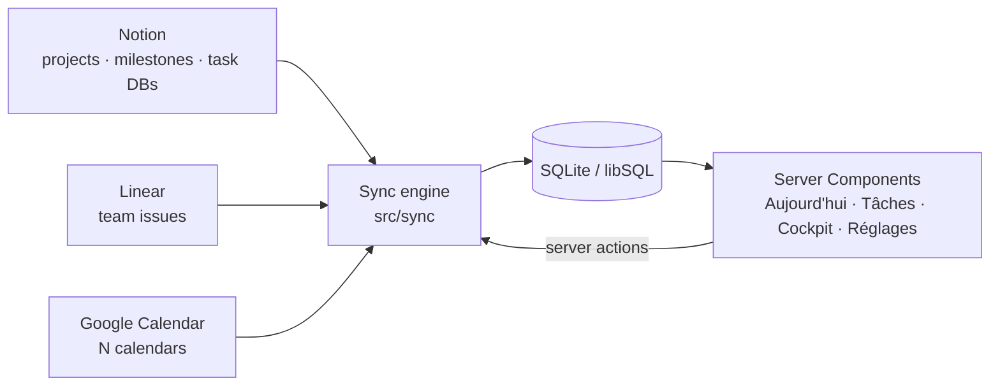

# Architecture

## Data flow



1. **Sources** (`sources` table) say what to read: `kind` (notion, linear, gcal), `role` (tasks, projects, milestones, reviews, events), an `externalRef`, and a JSON `config` holding the field mapping and routing hints (for example "every task from this database belongs to project X").
2. **Connectors** (`src/connectors/*`) implement:
   ```ts
   interface Connector {
     missingSetup(): Promise<string | null>; // human-readable reason it can't run
     pull(source): Promise<PullResult>;      // complete current state of that source
     discover(): Promise<Discovered[]>;      // everything the tool exposes
   }
   ```
3. **The sync engine** runs enabled sources in role order (projects → milestones → tasks → events), so that tasks can be linked to projects by name. Each source's result replaces that source's rows in one transaction. A failing source records its error and the others continue.
4. **Discovery** compares what each tool exposes with the registered sources and stores the rest in `discoveries`, which Réglages lists for one-click adoption.

## Notion specifics

- Uses the 2025+ **data sources** API. `externalRef` may be a data source id, a database id, or a page containing a database. `resolveDataSourceId` tries each in turn, walking up to two levels of child blocks (columns, toggles).
- `guessMapping` infers `titleProp`, `statusProp`, `dueProp` and the cockpit-specific properties (pilier, niveau, météo, prochaine action) from the schema. Explicit values in `config` win.
- Status normalisation uses the status property's **groups** (To-do / In progress / Complete), so custom option names still map correctly. Completed options are filtered at the API to keep pulls small.

## Linear specifics

Raw GraphQL (no SDK). It pulls open issues of the team (`state.type ∉ {completed, canceled}`) with assignee, project, due date and priority. `assignedToMe` compares against `viewer.id`, and unassigned tickets surface as "à trier". A `projectMap` in `config` maps Linear projects onto Cockpit projects.

## Google Calendar specifics

OAuth with offline access. Tokens live in the `settings` table, and refreshed tokens are persisted from the client's `tokens` event. The connector pulls a window from 7 days back to 6 weeks ahead with `singleEvents: true`. Each calendar has a `calendarRole` used by the time-blocking slice; events from a `cours` calendar whose title starts with `EV` are flagged as exams.

## Write-back (S2)

Every write to a source goes through `src/writeback/index.ts` (`changeTask`, `changeProject`, `createTask`, `undoChange`), which checks `isDemo()` before any API call, updates the local row, and appends a `change_log` entry (before, after, source, response). A field the source has no property for (a Notion base without `Priorité` or `Effort`) is kept in `task_overrides`, which `sync` re-applies after each pull unless the source row was edited after the override (**latest edit wins**; the conflict is logged). Connectors expose optional `updateTask`, `updateProject`, `createTask` and `canWrite`.

The priority of a task is computed at sync time by the pure `computePriority` (`src/engine/priority.ts`); project priority and status come from `projectScaleFromLevel` until edited in Cockpit (`priority_manual`).

Capture is parsed by `src/engine/capture.ts` (French dates, hours, `#tags`, kind prefixes) and routed by `suggestDestination` (rules, ticket pattern, project tag). What is not obvious waits in the `inbox` table.

## Dates

Every "day" is computed in **Europe/Paris** (`src/lib/dates.ts`) regardless of the server's timezone, using `Intl` only.

## Rendering

Next.js 16 with Cache Components: each page is a static shell with a `<Suspense>` boundary, and the data components call `connection()` to render at request time. Mutations are Server Actions that call `refresh()`.

## Security posture (current)

Single user, local only: the server binds to `127.0.0.1` and has no authentication yet. Secrets live in `.env.local`, and personal configuration in `config/seed.local.json`. Both are git-ignored. Authentication comes with hosting (slice 11).
