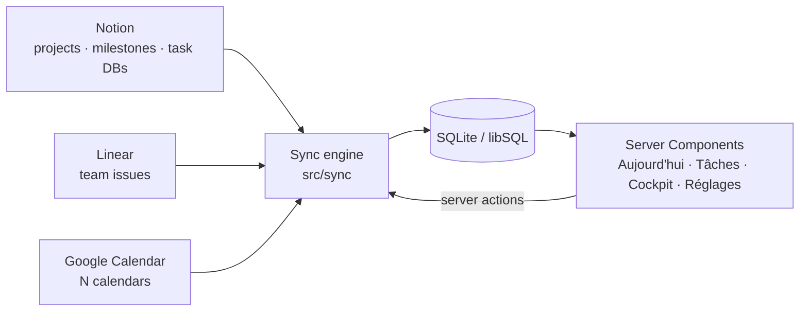

# Architecture

## Data flow



1. **Sources** (`sources` table) say what to read: `kind` (notion, linear, gcal), `role` (tasks, projects, milestones, reviews, events), an `externalRef`, and a JSON `config` holding the field mapping and routing hints (for example "every task from this database belongs to project X").
2. **Connectors** (`src/connectors/*`) implement:
   ```ts
   interface Connector {
     missingSetup(): Promise<string | null>; // human-readable reason it can't run
     pull(source): Promise<PullResult>;      // complete current state of that source
     discover(): Promise<Discovered[]>;      // everything the tool exposes
   }
   ```
3. **The sync engine** runs enabled sources in role order (projects → milestones → tasks → events), so that tasks can be linked to projects by name. Each source's result replaces that source's rows in one transaction. A failing source records its error and the others continue.
4. **Discovery** compares what each tool exposes with the registered sources and stores the rest in `discoveries`, which Réglages lists for one-click adoption.

## Notion specifics

- Uses the 2025+ **data sources** API. `externalRef` may be a data source id, a database id, or a page containing a database. `resolveDataSourceId` tries each in turn, walking up to two levels of child blocks (columns, toggles).
- `guessMapping` infers `titleProp`, `statusProp`, `dueProp` and the cockpit-specific properties (pilier, niveau, météo, prochaine action) from the schema. Explicit values in `config` win.
- Status normalisation uses the status property's **groups** (To-do / In progress / Complete), so custom option names still map correctly. Completed options are filtered at the API to keep pulls small.

## Linear specifics

Raw GraphQL (no SDK). It pulls open issues of the team (`state.type ∉ {completed, canceled}`) with assignee, project, due date and priority. `assignedToMe` compares against `viewer.id`, and unassigned tickets surface as "à trier". A `projectMap` in `config` maps Linear projects onto Cockpit projects.

## Google Calendar specifics

OAuth with offline access. Tokens live in the `settings` table, and refreshed tokens are persisted from the client's `tokens` event. The connector pulls a window from 7 days back to 6 weeks ahead with `singleEvents: true`. Each calendar has a `calendarRole` used by the time-blocking slice; events from a `cours` calendar whose title starts with `EV` are flagged as exams.

## Write-back (S2)

Every write to a source goes through `src/writeback/index.ts` (`changeTask`, `changeProject`, `createTask`, `undoChange`), which checks `isDemo()` before any API call, updates the local row, and appends a `change_log` entry (before, after, source, response). A field the source has no property for (a Notion base without `Priorité` or `Effort`) is kept in `task_overrides`, which `sync` re-applies after each pull unless the source row was edited after the override (**latest edit wins**; the conflict is logged). Connectors expose optional `updateTask`, `updateProject`, `createTask` and `canWrite`.

The priority of a task is computed at sync time by the pure `computePriority` (`src/engine/priority.ts`); project priority and status come from `projectScaleFromLevel` until edited in Cockpit (`priority_manual`).

Capture is parsed by `src/engine/capture.ts` (French dates, hours, `#tags`, kind prefixes) and routed by `suggestDestination` (rules, ticket pattern, project tag). What is not obvious waits in the `inbox` table.

## Blocks and the replan (S3)

Every event on a `travail` or `perso` calendar is a **block** (`blocks` table, same id as its event). `reconcileBlocks` (`src/planning`) runs after each sync: it mirrors the events into blocks (a block moved by hand in Google Calendar keeps the new time and is never moved back), links them to tasks (`cockpit:task=<id>` marker in the description, else a ticket identifier in the title), then sets each block's status with the pure `reconcileBlockStatus` (task closed in its source → `done`; end + grace passed with the task open → `missed`, which feeds **À replacer**). A block that ends `done` teaches the task type's minutes per point (moving average).

`src/engine/planning.ts` holds the rules, all pure and unit-tested: `freeSlots` (work window Mon–Sat 09:00–22:00; protected `socle`/`cours` and busy events removed; `engagement` overlaps are kept as slots tagged `avoidedIds`, usable only with approval), `placeTask`, `placeSplit`, `replanDay` (mandatory first, then habits, then the rest; blocks stay put when they can; overload is reported as `unplaceable`/`dropped`, never silent), `durationFor` and `learnMinutesPerPoint`.

Calendar writes live in `src/writeback/blocks.ts` and `src/connectors/gcal.ts`. Each goes through `assertWritableCalendar` (only `travail` and `perso`) and checks `isDemo()` first; in demo mode only the local `events` and `blocks` tables change. Every state change and replan decision is appended to `block_log`.

## Le cap and la clôture (S5)

`src/engine/cloture.ts` holds the pure rules, all unit-tested: `suggestTop3` (Urgent and Haute work plus anything due, never more than three), `pickFirstAction`, `buildSnapshot` / `diffSnapshots` / `findClashes` (what changed since the evening: new or changed tickets, moved or added events, new clashes between a block and a non-block event) and the habit maths (`weeklyPct`, `missedTwoWeeks`). `src/rituals/` reads and writes the database: `day_plans` holds one row per day (the première action and top 3 chosen the evening before, `closedAt` and the `snapshot` of the day once closed, `startedAt` for *C'est parti*, `catchUpAt` for the morning catch-up), `habits` / `habit_logs` the habit ticks. Closing day D writes row D (`closedAt`, `snapshot`) and row D+1 (the plan). The "Restes" step and *C'est parti* move blocks through the S3 planner (`applyLeftover`, `moveBlockToNow`), so the same rules apply: protected events are never overlapped and calendar writes stay on travail/perso. Ritual times live in the `rituals` setting (`src/rituals/settings.ts`) and also drive `loadNotifySettings`, so the notifications follow them. `COCKPIT_NOW` (an instant, or a Paris wall time `YYYY-MM-DDTHH:mm`) moves the clock through `nowMs()` in `src/lib/dates.ts`, but only in demo mode and in tests.

## Dates

Every "day" is computed in **Europe/Paris** (`src/lib/dates.ts`) regardless of the server's timezone, using `Intl` only.

## Rendering

Next.js 16 with Cache Components: each page is a static shell with a `<Suspense>` boundary, and the data components call `connection()` to render at request time. Mutations are Server Actions that call `refresh()`.

## Security posture

Single user, passkey only (WebAuthn, `src/lib/auth`). The first passkey needs the one-time `COCKPIT_SETUP_TOKEN` and no existing credential; later ones need a session. A session is a random token, stored hashed in `sessions`, carried in a signed, HTTP-only, `SameSite=Lax`, `Secure` cookie (30 days, sliding).

Defence in depth: `src/proxy.ts` is an optimistic gate in front of every page and route (signed cookie present and not expired); each server action and route handler calls `requireAuth()` again against the database, because Server Functions can be POSTed directly. Machine endpoints (`/api/sync`, `/api/cron/tick`, `/api/capture`) are open to the proxy and check their own bearer token (`COCKPIT_CRON_TOKEN`, `COCKPIT_CAPTURE_TOKEN`). `COCKPIT_DEMO=1` and `COCKPIT_AUTH=off` (local development only) disable authentication.

Secrets live in environment variables (`.env.local` locally, Vercel in production); personal configuration in `config/seed.local.json`, git-ignored.

## Phone, PWA and notifications (S4)

`app/manifest.ts` and `public/sw.js` make the app installable: the service worker caches the build output and the last Aujourd'hui for read-only offline use (with a "hors ligne" banner) and never caches `/api/` responses. Push uses `web-push` with VAPID keys; subscriptions are stored in `push_subscriptions`. `/api/cron/tick` (called every 5 minutes by `.github/workflows/cron.yml`) syncs, asks the pure `dueNotifications` (`src/engine/notifications.ts`) what is due, sends it and records each key in `notifications_sent`, so a notification goes out once. Production schema changes ship as versioned migrations in `drizzle/` (`npm run db:migrate`); `db:push` is for local development. See [DEPLOY.md](DEPLOY.md).
